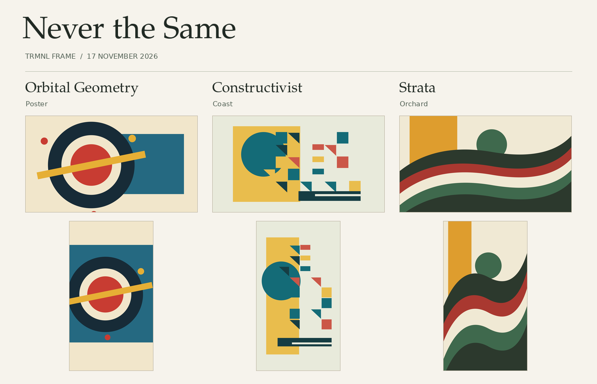

# Never the Same

Prototype for a private TRMNL plugin that can be submitted as a recipe after in-account review. It polls a small artwork manifest and displays a full-bleed PNG. The Node service draws seeded SVG compositions and rasterizes them with Sharp. It needs no database or third-party image service.



## Run locally

Requires Node.js 22 or later.

```sh
npm install
npm test
npm start
curl 'http://127.0.0.1:8787/v1/artwork?zone=Europe%2FZurich&style=strata'
```

Open either image URL from the JSON response to see the full-resolution PNG. Daily editions follow the account time zone, with UTC as the fallback. Weekly editions begin Monday. The 60-minute polling interval governs when TRMNL fetches manifest updates. When the frame shows the updated image also depends on its refresh schedule.

## Install privately on TRMNL

### Deploy the artwork API

[](https://render.com/deploy?repo=https%3A%2F%2Fgithub.com%2Fmichaelkurath%2FTRMNL-Never-the-Same)

The Render blueprint creates one free Node web service in Frankfurt. Render supplies the public HTTPS origin automatically. After the service is live, check `/health` and `/v1/artwork?zone=Europe%2FZurich` on its assigned hostname. The first returns a health status and the second returns two public image URLs. Render's free tier can take about a minute to wake after inactivity, so it is intended for initial testing.

### Connect the plugin

1. Run the API on a host reachable by TRMNL over HTTPS. Set `PUBLIC_ORIGIN` to its public HTTPS origin, such as `https://artwork.example.com`, so the manifest returns publicly reachable image URLs. Set `HOST=0.0.0.0` if required by your hosting environment and configure `PORT` to match the reverse proxy. A CDN may cache the immutable image paths.
2. In TRMNL, open **Plugins → Private Plugins → Import new**, then select [Never_the_Same_TRMNL_Import.zip](https://github.com/michaelkurath/TRMNL-Never-the-Same/raw/refs/heads/main/Never_the_Same_TRMNL_Import.zip). Edit the imported plugin and enter your API hostname, without a scheme or path.
3. Save, force a refresh, and check the full preview in both orientations. Check the four layout previews and the device playlist before submitting anything to the recipe catalog.

If you already installed the private plugin with the fixed preview, use the existing plugin. Replace **Artwork API hostname** with the deployed hostname. Restore the dynamic **Polling URL** below and click **Force Refresh**:

```liquid
https://{{ api_host }}/v1/artwork?zone={{ trmnl.user.time_zone_iana | url_encode }}&cadence={{ cadence | url_encode }}&style={{ art_style | url_encode }}&palette={{ palette | url_encode }}&density={{ density | url_encode }}&seed={{ edition_seed | url_encode }}
```

[TRMNL import documentation](https://help.trmnl.com/en/articles/10542599-importing-and-exporting-private-plugins)

## Edition settings

| Setting | Choices |
| --- | --- |
| New artwork | Daily or weekly |
| Composition | Rotating Gallery, Orbital Geometry, Constructivist, Strata, Flow Fields, Topographic, Organic Growth |
| Palette | Rotating Palette, Poster, Coast, Orchard, Ink |
| Density | Balanced or layered |
| Personal seed | Optional. Devices with the same account-local edition date and matching settings can reproduce the same composition for a given orientation. |

Rotating Gallery cycles through all six styles. Flow Fields draws sweeping ribbons, Topographic builds nested contours, and Organic Growth traces branching stems and leaves. The image URL contains a versioned edition ID and is immutable. Bump the renderer version and keep serving existing versioned routes if a future release changes how an existing ID renders.

Frame landscape and portrait use native 2560 × 1440 and 1440 × 2560 PNGs. Mashups choose artwork by their own aspect ratio and may crop. The preview shows the software colors before TRMNL's Spectra 6 conversion. The API, edition boundaries, and image dimensions were tested locally. Live import, on-device rendering, color conversion, and Clock Sync remain to be verified.
